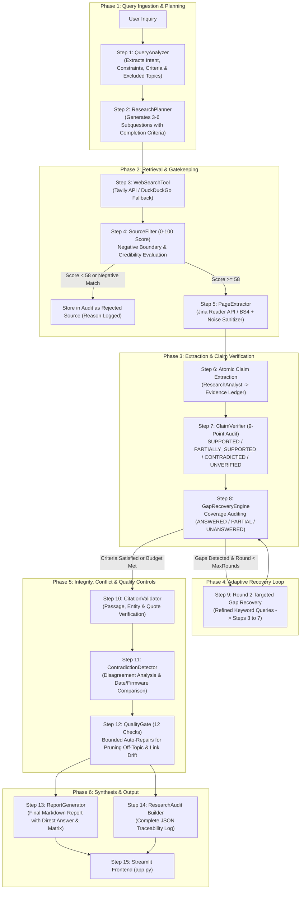
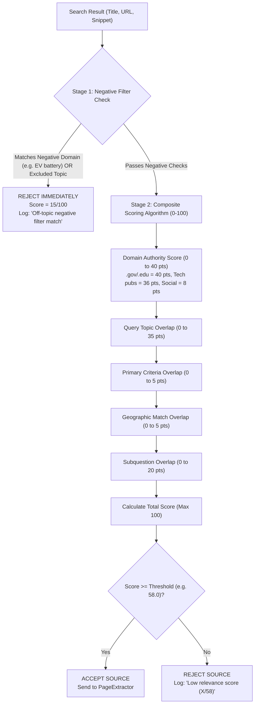
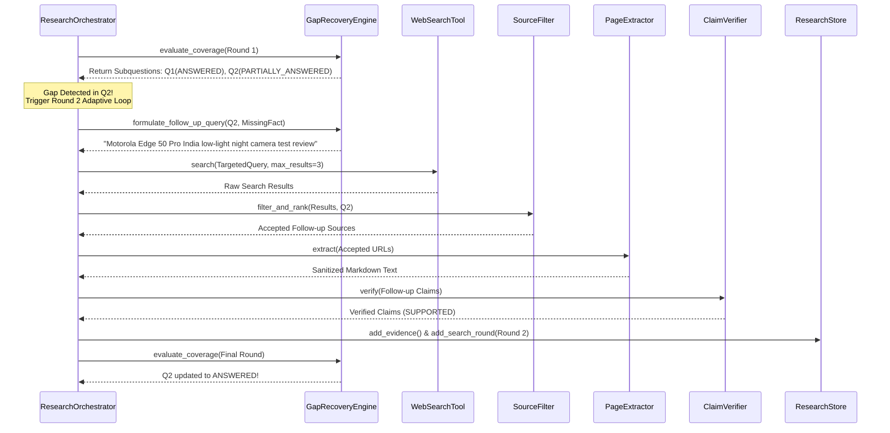
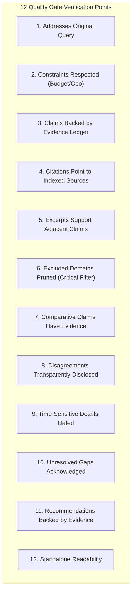

# ResearchPilot AI — End-to-End Architectural Deep Dive

This document provides a comprehensive, step-by-step breakdown of the **ResearchPilot AI** architecture. It details every component, data schema, heuristic, LLM interaction, validation gate, and feedback loop that transforms a raw, ambiguous user inquiry into a rigorously verified, evidence-backed research report.

---

## Table of Contents
1. [Architectural Overview & Core Paradigms](#1-architectural-overview--core-paradigms)
2. [End-to-End Architecture Flowchart](#2-end-to-end-architecture-flowchart)
3. [Step 1: Ingestion & Query Analysis (`QueryAnalyzer`)](#step-1-ingestion--query-analysis-queryanalyzer)
4. [Step 2: Dynamic Criteria-Driven Research Planning (`ResearchPlanner`)](#step-2-dynamic-criteria-driven-research-planning-researchplanner)
5. [Step 3: Targeted Search Formulation & Retrieval (`WebSearchTool`)](#step-3-targeted-search-formulation--retrieval-websearchtool)
6. [Step 4: Dual-Stage Strict Source Relevance Filtering (`SourceFilter`)](#step-4-dual-stage-strict-source-relevance-filtering-sourcefilter)
7. [Step 5: Web Content Extraction, Noise Scrubbing & Resilience (`PageExtractor`)](#step-5-web-content-extraction-noise-scrubbing--resilience-pageextractor)
8. [Step 6: Atomic Claim Extraction & Evidence Ledgering (`ResearchAnalyst` & `ResearchStore`)](#step-6-atomic-claim-extraction--evidence-ledgering-researchanalyst--researchstore)
9. [Step 7: Rigorous 9-Point Claim-Level Verification (`ClaimVerifier`)](#step-7-rigorous-9-point-claim-level-verification-claimverifier)
10. [Step 8: Research Question Coverage Auditing (`GapRecoveryEngine`)](#step-8-research-question-coverage-auditing-gaprecoveryengine)
11. [Step 9: Adaptive Research Feedback Loop (Round 2 Targeted Gap Recovery)](#step-9-adaptive-research-feedback-loop-round-2-targeted-gap-recovery)
12. [Step 10: Citation Integrity Validation (`CitationValidator`)](#step-10-citation-integrity-validation-citationvalidator)
13. [Step 11: Independent Corroboration & Contradiction Detection (`ContradictionDetector`)](#step-11-independent-corroboration--contradiction-detection-contradictiondetector)
14. [Step 12: Independent 12-Point Final Quality Gate (`QualityGate`)](#step-12-independent-12-point-final-quality-gate-qualitygate)
15. [Step 13: Final Report Synthesis (`ReportGenerator`)](#step-13-final-report-synthesis-reportgenerator)
16. [Step 14: Isolated Machine-Readable Research Audit (`ResearchAudit`)](#step-14-isolated-machine-readable-research-audit-researchaudit)
17. [Step 15: Presentation Layer & UI Integration (`app.py`)](#step-15-presentation-layer--ui-integration-apppy)
18. [Summary of State Transitions & Schemas](#18-summary-of-state-transitions--schemas)

---

## 1. Architectural Overview & Core Paradigms

### What Type of System is ResearchPilot AI?
ResearchPilot AI is a **Hierarchical Multi-Stage Orchestrated Agentic Workflow (Supervisor Pattern)** with a **Controlled Adaptive Feedback Loop**. 

It is **NOT an AI Swarm**. In an AI swarm, autonomous agents communicate peer-to-peer without central control, leading to unpredictable routing. ResearchPilot AI uses a centralized supervisor ([`ResearchOrchestrator`](file:///c:/Users/battu/Desktop/myprojects/ResearchPilot/agent/orchestrator.py)) coordinating specialized components that operate against a thread-safe shared state ([`ResearchStore`](file:///c:/Users/battu/Desktop/myprojects/ResearchPilot/storage/research_store.py)).

### Foundational Design Principles
1. **Evidence Grounding Over Model Memory**: A statement is treated as factual only if substantiated by an audited excerpt in the Evidence Ledger.
2. **URL Non-Equivalence to Truth**: The mere existence of a URL does not validate a claim. The text at that URL must be retrieved, inspected, and shown to substantiate the exact statement.
3. **Negative Boundary Enforcement**: Irrelevant domains (e.g. electric vehicle batteries during a smartphone search) are filtered at the search, extraction, claim, and quality gate stages.
4. **Rejection of Unsubstantiated Comparative Superlatives**: Technical specifications (e.g. *"features a 50 MP sensor"*) cannot prove comparative superiority (*"this is the best camera phone"*). Comparative claims require comparative evidence.
5. **Aspect & Freshness Separation**: Reviews of daylight photography cannot substantiate low-light performance; stale pricing from outdated articles cannot verify current prices.
6. **Separation of Concerns**: User reports provide direct answers and clickable links; audit metadata is kept separate in a dedicated audit file.

---

## 2. End-to-End Architecture Flowchart



---

## Step 1: Ingestion & Query Analysis (`QueryAnalyzer`)

**Source File:** [`agent/query_analyzer.py`](file:///c:/Users/battu/Desktop/myprojects/ResearchPilot/agent/query_analyzer.py)

### Objective
Understand what the user is asking, extract hard constraints, identify decision criteria, and set negative boundaries to prevent off-topic retrieval.

### How It Works Deeply
1. **Cleaning & Normalization**: The raw string is stripped of excess whitespace.
2. **LLM Semantic Parsing**: A structured prompt is sent to the LLM backend ([`agent/llm_client.py`](file:///c:/Users/battu/Desktop/myprojects/ResearchPilot/agent/llm_client.py)) with instructions to output JSON matching `QueryAnalysisOutput`:
   - `main_intent`: Categorizes the goal (e.g., `product_recommendation`, `scientific_evaluation`, `technical_comparison`).
   - `domain`: Identifies the industry/field (e.g., `smartphones`, `laptops`, `healthcare_ai`, `cryptography`).
   - `topic` & `subtopics`: Specific technical domains under investigation.
   - `explicit_constraints`: Hard parameters (e.g., `max_budget: 30000`, `currency: "INR"`, `geo: "India"`).
   - `primary_criteria`: The core priorities (e.g., `camera quality`, `low light photo`, `optical stabilization`). Non-requested dimensions (like gaming benchmarks or refresh rates) are explicitly deprioritized.
   - `secondary_criteria`: Helpful supporting factors (e.g., `battery life`, `display`, `OS updates`).
   - `geographic_scope`: Identifies relevant markets (e.g., `India`, `Global`).
   - `time_sensitivity`: Distinguishes current market queries from historical surveys.
   - `excluded_topics`: Identifies potential false keyword matches. For example, for smartphone battery searches, it adds `["electric vehicles", "ev battery", "automotive charging", "commercial fleet"]`.
3. **Deterministic Heuristic Fallback**: If LLM API quotas are exhausted (HTTP 429) or offline, `_heuristic_analyze` extracts currency symbols (`₹`, `$`, `Rs`), numeric ceilings, geographic tokens, and domain keywords using regex patterns.
4. **State Storage**: Generates a [`QueryIntent`](file:///c:/Users/battu/Desktop/myprojects/ResearchPilot/models/schemas.py#L30) object stored in the central [`ResearchStore`](file:///c:/Users/battu/Desktop/myprojects/ResearchPilot/storage/research_store.py).

---

## Step 2: Dynamic Criteria-Driven Research Planning (`ResearchPlanner`)

**Source File:** [`agent/planner.py`](file:///c:/Users/battu/Desktop/myprojects/ResearchPilot/agent/planner.py)

### Objective
Deconstruct the inquiry into 3 to 6 targeted research subquestions, each with justifications and completion criteria.

### How It Works Deeply
1. **Context-Driven Prompting**: The planner receives the `QueryIntent` output (primary criteria, constraints, and excluded topics).
2. **Subquestion Schema Enforcement**: Each generated subquestion conforms to [`ResearchQuestion`](file:///c:/Users/battu/Desktop/myprojects/ResearchPilot/models/schemas.py#L125):
   ```json
   {
     "question_id": "Q1",
     "question_text": "Which smartphone models under INR 30000 in India offer the strongest camera hardware (e.g. Sony LYT/IMX sensors, OIS)?",
     "dimension": "camera_top_picks",
     "reason": "Identify the primary candidate devices that fit the price ceiling and feature dedicated camera hardware.",
     "required_evidence": "Camera sensor specifications and OIS validation across candidate models.",
     "preferred_source_types": ["independent_review", "tech_publication", "official_specs"],
     "completion_criteria": "At least 2 verified candidate devices identified with validated sensor and OIS details.",
     "status": "PLANNED",
     "confidence": 0.0,
     "source_ids": [],
     "evidence_ids": []
   }
   ```
3. **Criteria Isolation**: The prompt instructs the model to ignore off-topic questions. For a camera mobile query, questions focus on sensor size, low light, portraits, and pricing—not desktop GPUs or electric engines.
4. **Heuristic Fallback Engine**: If the LLM is unreachable, `_heuristic_plan` generates domain-specific templates dynamically filled with user constraints.
5. **State Storage**: Wraps questions into a [`ResearchPlan`](file:///c:/Users/battu/Desktop/myprojects/ResearchPilot/models/schemas.py#L143) and registers it in `ResearchStore`.

---

## Step 3: Targeted Search Formulation & Retrieval (`WebSearchTool`)

**Source File:** [`tools/web_search.py`](file:///c:/Users/battu/Desktop/myprojects/ResearchPilot/tools/web_search.py) & [`agent/orchestrator.py`](file:///c:/Users/battu/Desktop/myprojects/ResearchPilot/agent/orchestrator.py#L48-L68)

### Objective
Generate concise search queries and retrieve credible web results without search noise.

### How It Works Deeply
1. **Query Construction (`_build_search_query`)**:
   - Rather than sending conversational sentences to search engines, the orchestrator combines:
     $$\text{Search Query} = [\text{Topic}] + [\text{Budget/Constraint}] + [\text{Geographic Scope}] + [\text{Subquestion Keywords}]$$
   - Filters out non-searchable conversational terms (`"what"`, `"which"`, `"compare"`, `"options"`, `"does"`, `"have"`).
   - Limits search string length to $\le 100$ characters for optimal search relevance.
2. **Multi-Tier Search Engine**:
   - **Tier 1 (Tavily AI Search API)**: When `TAVILY_API_KEY` is present, executes `POST https://api.tavily.com/search`. Tavily cleans and filters spam, returning structured titles, URLs, and snippets.
   - **Tier 2 (DuckDuckGo Live Search)**: If Tavily is absent or rate-limited, queries DuckDuckGo via the `ddgs` library.
   - **Tier 3 (Offline Mock Fallback)**: For unit tests, returns mock results.
3. **URL Normalization**: Normalizes URLs to prevent duplicates: strips tracking parameters (`utm_source`, `ref`, `fbclid`, `gclid`), converts schemes to lowercase, and strips trailing slashes.

---

## Step 4: Dual-Stage Strict Source Relevance Filtering (`SourceFilter`)

**Source File:** [`tools/source_filter.py`](file:///c:/Users/battu/Desktop/myprojects/ResearchPilot/tools/source_filter.py)

### Objective
Prevent off-topic, spam, or low-credibility sources from entering the evidence pool.

### How It Works Deeply
Every search result passes through a dual-stage gatekeeper:



1. **Stage 1: Negative Domain & Excluded Topic Check**:
   - Compares text against `OFF_TOPIC_NEGATIVE_PATTERNS[intent.domain]`. For example:
     - Smartphones: `r"\belectric vehicle\b"`, `r"\bev battery\b"`, `r"\bcharging station\b"`, `r"\bfleet\b"`, `r"\bstock quote\b"`.
   - Also checks against `intent.excluded_topics`.
   - Any match results in immediate rejection (score $\le 20.0$), logging the reason in the audit.
2. **Stage 2: Composite Relevance Scoring (0 to 100)**:
   - **Domain Credibility (max 40 pts)**: High-credibility domains (`gsmarena.com`, `91mobiles.com`, `nature.com`, `nist.gov`) receive full points; low-credibility/social domains (`reddit.com`, `quora.com`, `tiktok.com`) receive minimal points.
   - **Topic Overlap (max 35 pts)**: Proportion of core topic words found in the snippet.
   - **Primary Criteria Bonus (+5 pts)**: Keyword matches for primary criteria (e.g. `OIS`, `low-light`).
   - **Geographic Match Bonus (+5 pts)**: Matches for regional scope (e.g. `India`).
   - **Subquestion Specificity (max 20 pts)**: Overlap with the subquestion's specific dimension.
3. **Partitioning & Audit Logging**:
   - Sources with scores $\ge \text{threshold}$ are accepted and passed to `PageExtractor`.
   - Rejected sources are logged in `ResearchStore.rejected_sources` with their exact score and rejection reason.

---

## Step 5: Web Content Extraction, Noise Scrubbing & Resilience (`PageExtractor`)

**Source File:** [`tools/page_extractor.py`](file:///c:/Users/battu/Desktop/myprojects/ResearchPilot/tools/page_extractor.py)

### Objective
Fetch full web page contents, strip ads/boilerplate, detect scraper errors, and convert messy HTML into sanitized Markdown.

### How It Works Deeply
1. **Extraction Engines**:
   - **Primary (Jina Reader API)**: Requests `https://r.jina.ai/<url>` with `READER_API_KEY`. Jina uses a cloud headless browser to render single-page applications, strip scripts and popups, and return clean Markdown.
   - **Fallback (Direct HTTP + BeautifulSoup4)**: If Jina is disabled or times out, uses `requests.get` with desktop browser headers (`DEFAULT_HEADERS`), parses semantic tags (`<article>`, `<main>`, `<div id="content">`), and strips noise tags (`<script>`, `<style>`, `<nav>`, `<footer>`, `<aside>`, `<form>`).
2. **Error & Captcha Detection**:
   - Evaluates content against `ERROR_PATTERNS`:
     - `403 Forbidden`, `Access Denied`, `Attention Required | Cloudflare`, `Please verify you are a human`.
   - Pages matching these patterns are marked `status = "failed"`. The system handles this gracefully rather than parsing captcha error pages as evidence.
3. **Regex Noise Sanitization Engine (`_sanitize_and_validate`)**:
   - Strips Jina metadata lines (`Title:`, `URL Source:`, `Markdown Content:`).
   - Removes navigation artifacts (`[Skip to navigation]`, `Trending Tickers`, `October Prime Day`).
   - Removes cookie banners and affiliate disclaimers.
   - **Table Sanitizer**: Converts raw Markdown table dumps into readable key-value specification lines (`Spec: Value`).

---

## Step 6: Atomic Claim Extraction & Evidence Ledgering (`ResearchAnalyst` & `ResearchStore`)

**Source Files:** [`agent/analyst.py`](file:///c:/Users/battu/Desktop/myprojects/ResearchPilot/agent/analyst.py) & [`storage/research_store.py`](file:///c:/Users/battu/Desktop/myprojects/ResearchPilot/storage/research_store.py)

### Objective
Extract atomic factual claims from extracted web text and register them into the structured Evidence Ledger.

### How It Works Deeply
1. **Noise Pre-Screening**: Rejects snippets that contain scraper artifacts, tables with $> 2$ pipe characters, or texts under 20 characters.
2. **Claim Extraction with LLM**:
   - Sends the cleaned text excerpt ($\le 3,500$ chars) to the LLM alongside the subquestion and `QueryIntent`.
   - Enforces the schema:
     - `claim_text`: A concise factual statement ($\le 250$ chars) directly answering the subquestion.
     - `supporting_excerpt`: The exact sentence from the source text ($\le 200$ chars) substantiating the claim.
     - `evidence_type`: Marked as `"direct"` or `"inference"`.
3. **Heuristic Sentence Extraction Fallback**: If the LLM is unavailable, `_heuristic_extract_claims` tokenizes content into sentences, calculates keyword overlap with the subquestion, filters noise, and extracts the top scoring sentences.
4. **Deduplication & Ledger Registration**:
   - Claims are normalized (lowercased, punctuation removed) to deduplicate repeated statements across sources.
   - Saves to the Evidence Ledger as an [`Evidence`](file:///c:/Users/battu/Desktop/myprojects/ResearchPilot/models/schemas.py#L67) / [`EvidenceItem`](file:///c:/Users/battu/Desktop/myprojects/ResearchPilot/models/schemas.py#L90) record with a unique `evidence_id` (`EVD_001`), linking source IDs and subquestion IDs.

---

## Step 7: Rigorous 9-Point Claim-Level Verification (`ClaimVerifier`)

**Source File:** [`agent/claim_verifier.py`](file:///c:/Users/battu/Desktop/myprojects/ResearchPilot/agent/claim_verifier.py)

### Objective
Evaluate every extracted claim against its supporting excerpt to assign an evidence status.

### The 9 Verification Checks
Every candidate claim passes through nine checks:

| Check | What It Evaluates | How It Is Enforced |
|---|---|---|
| **1. Exact Passage Support** | Does the excerpt substantiate the claim? | Checks semantic alignment and keyword overlap ($\ge 60\%$). |
| **2. Entity & Variant Match** | Does the excerpt discuss the correct model/subject? | Checks that named entities (e.g. *Motorola Edge 50 Pro*) match. |
| **3. Scope Completeness** | Does the excerpt substantiate all parts of the claim? | Missing metrics result in `PARTIALLY_SUPPORTED`. |
| **4. Unmentioned Details** | Does the claim introduce unmentioned details? | Claims with details absent from the excerpt are flagged as unverified. |
| **5. Comparative Superlatives** | Does a comparative claim have comparative evidence? | Claims like *"best camera phone"* or *"superior"* backed only by spec sheets return `UNVERIFIED`. |
| **6. Aspect Alignment** | Does the excerpt cover the specific aspect claimed? | Claims about *low-light/night* photography backed only by *daylight* reviews return `UNVERIFIED`. |
| **7. Price Freshness** | Is current pricing backed by current sources? | Price claims from stale sources ($> 1$ year old) return `UNVERIFIED`. |
| **8. Contradiction Detection** | Does the excerpt contradict the claim? | Excerpts with negation patterns (*"failed to"*, *"does not"*) return `CONTRADICTED`. |
| **9. Confidence Calibration** | Is confidence properly scaled? | Supported facts score $\ge 0.85$; partial facts score $\le 0.70$. |

### Verification Statuses
- `SUPPORTED`: Excerpt clearly and sufficiently substantiates the complete claim.
- `PARTIALLY_SUPPORTED`: Excerpt corroborates the general topic but leaves specific metrics unconfirmed.
- `CONTRADICTED`: Excerpt contradicts the claim.
- `UNVERIFIED`: Excerpt is off-topic, stale, or lacks comparative evidence.

---

## Step 8: Research Question Coverage Auditing (`GapRecoveryEngine`)

**Source File:** [`agent/gap_recovery.py`](file:///c:/Users/battu/Desktop/myprojects/ResearchPilot/agent/gap_recovery.py)

### Objective
Determine whether each research question has collected sufficient evidence to meet its completion criteria.

### Coverage Classification Rules
For each subquestion $Q_i$, the engine evaluates all associated evidence items:

```
If (Count(SUPPORTED) >= 2) OR (Count(SUPPORTED) >= 1 AND Count(PARTIALLY_SUPPORTED) >= 1):
    Status = ANSWERED, Confidence = 0.92

Else If (Count(SUPPORTED) == 1) OR (Count(PARTIALLY_SUPPORTED) >= 1):
    Status = PARTIALLY_ANSWERED, Confidence = 0.65
    MissingFact = "Secondary comparative metrics for [dimension]"
    GapCause = "missing_sources"

Else If Count(CONTRADICTED) >= 1:
    Status = UNANSWERED / PARTIALLY_ANSWERED, Confidence = 0.40
    MissingFact = "Consensus resolution between opposing sources"
    GapCause = "conflicting_evidence"

Else If Sources Rejected > 0 AND Count(Evidence) == 0:
    Status = UNANSWERED, Confidence = 0.20
    MissingFact = "Direct evidence satisfying criteria"
    GapCause = "irrelevant_sources"

Else:
    Status = UNANSWERED, Confidence = 0.15
    MissingFact = "Verified facts addressing question"
    GapCause = "missing_sources"
```

---

## Step 9: Adaptive Research Feedback Loop (Round 2 Targeted Gap Recovery)

**Source Files:** [`agent/gap_recovery.py`](file:///c:/Users/battu/Desktop/myprojects/ResearchPilot/agent/gap_recovery.py) & [`agent/orchestrator.py`](file:///c:/Users/battu/Desktop/myprojects/ResearchPilot/agent/orchestrator.py#L263-L365)

### Objective
Automatically formulate targeted follow-up queries and retrieve missing evidence for unresolved questions.



### Gap Formulation Strategy
The engine builds targeted search queries:
$$\text{Follow-up Query} = [\text{Topic}] + [\text{Geographic Scope}] + [\text{Dimension}] + [\text{Missing Criteria}]$$
- Example Round 1 query: `"camera smartphones under INR 30000 India models"`
- Example Round 2 gap query: `"camera smartphones India low_light_performance comparative test results night mode"`

---

## Step 10: Citation Integrity Validation (`CitationValidator`)

**Source File:** [`agent/citation_validator.py`](file:///c:/Users/battu/Desktop/myprojects/ResearchPilot/agent/citation_validator.py)

### Objective
Ensure every citation in the report maps to a real source, excerpt, and entity before publication.

### Integrity Validation Checks
1. **Source Presence**: Checks if the source ID exists in `run.sources`. If the source was rejected or extraction failed, returns `SOURCE_UNAVAILABLE`.
2. **Passage Verification (`passage_verified`)**: Verifies that the excerpt words appear in the stored source content.
3. **Quotation Fidelity**: For claims containing quotes (`"`), checks that the quoted text appears verbatim in the source. If altered or fabricated, returns `INVALID`.
4. **Entity Match (`entity_match`)**: Extracts proper nouns and model names from the claim and verifies their presence in the source.
5. **Claim Support (`claim_supported`)**: Validates factual overlap between claim and source text.
6. **Output Record**: Generates [`CitationValidation`](file:///c:/Users/battu/Desktop/myprojects/ResearchPilot/models/schemas.py#L98) with statuses:
   - `VALID`, `PARTIALLY_VALID`, `INVALID`, `SOURCE_UNAVAILABLE`.

---

## Step 11: Independent Corroboration & Contradiction Detection (`ContradictionDetector`)

**Source File:** [`agent/contradiction_detector.py`](file:///c:/Users/battu/Desktop/myprojects/ResearchPilot/agent/contradiction_detector.py)

### Objective
Identify, analyze, and document disagreements between independent reviews.

### Disagreement Analysis Protocol
1. **Pairwise Examination**: Inspects evidence pairs within the same research subquestion.
2. **Divergence Detection**: Identifies opposing assertions on the same subject (e.g. positive assessments like *"strong low-light clarity"* vs negative assessments like *"noisy output"*).
3. **Explanatory Comparison**:
   - **Publication Dates**: Checks whether one review is older (identifying potential software/firmware updates).
   - **Testing Methodology**: Compares testing environments (e.g. daylight vs night, lab charts vs real-world).
   - **Variant Discrepancies**: Checks for differing storage configurations or retailer discounts.
4. **Audit Logging**: Saves structured [`ContradictionRecord`](file:///c:/Users/battu/Desktop/myprojects/ResearchPilot/models/schemas.py#L110) objects with `resolution_status = "UNRESOLVED_DISCLOSED"`.
5. **Report Section**: Injects this analysis into Section 5 (*"Trade-offs and Conflicting Evidence"*).

---

## Step 12: Independent 12-Point Final Quality Gate (`QualityGate`)

**Source File:** [`agent/quality_gate.py`](file:///c:/Users/battu/Desktop/myprojects/ResearchPilot/agent/quality_gate.py)

### Objective
An independent auditor that validates the final report against the Evidence Ledger before publication.

### The 12 Quality Gate Conditions



### Bounded Automated Repair Mechanism
If critical failures are detected, the Quality Gate executes targeted automated repairs:
- **Off-Topic Finding Detected**: Automatically prunes the off-topic sentence from `report.key_findings` and logs the repair.
- **Unverified Comparative Claim Detected**: Qualifies or removes comparative superlatives (*"best in class"*) lacking comparative evidence.
- **Missing Limitations Disclosure**: Injects explicit disclosures for unresolved subquestions.
- **Gate Decision**: If all critical failures are resolved and score $\ge 0.80$, sets `report_passed = True`. Otherwise, rejects publication and flags remaining failures for review.

---

## Step 13: Final Report Synthesis (`ReportGenerator`)

**Source File:** [`agent/report_generator.py`](file:///c:/Users/battu/Desktop/myprojects/ResearchPilot/agent/report_generator.py)

### Objective
Assemble an evidence-grounded research report centered on a direct answer and verified candidate recommendations.

### Report Structure
1. **Title & Run Metadata**: Clean title, inquiry statement, timestamp, and unique run ID.
2. **Section 1: Executive Summary (Direct Answer)**: Answers the user's inquiry directly in the opening paragraph.
3. **Section 2: Research Scope and Methodology**: Details the research process and displays coverage status for all planned subquestions.
4. **Section 3: Key Findings & Candidate Comparison Table**:
   - Bulleted recommendations with verified facts and markdown source links (`[Publisher](url)`).
   - Side-by-side Markdown comparison matrix tailored to the user's primary criteria.
5. **Section 4: Evidence and Citations**: A traceable table mapping each claim ID to its verification status, exact supporting excerpt, and clickable source link.
6. **Section 5: Comparison of Findings & Conflicting Evidence**: Transparent disclosure of review discrepancies and testing conditions.
7. **Section 6: Actionable Recommendations**: Decision advice and buying considerations based on verified evidence.
8. **Section 7: Limitations and Uncertainty**: Explicit disclosure of unresolved questions and data boundaries.
9. **Section 8 & 9: Budget Summary & References**: List of accepted sources with URLs, publishers, and retrieval dates.

---

## Step 14: Isolated Machine-Readable Research Audit (`ResearchAudit`)

**Source Files:** [`agent/report_generator.py`](file:///c:/Users/battu/Desktop/myprojects/ResearchPilot/agent/report_generator.py#L125-L255) & [`models/schemas.py`](file:///c:/Users/battu/Desktop/myprojects/ResearchPilot/models/schemas.py#L170-L190)

### Objective
Provide developers and auditors with complete traceability for every decision, source rejection, claim evaluation, and query execution.

### Audit JSON Schema
```json
{
  "run_id": "run_20261009_172901_ac8310",
  "original_query": "Suggest me a good camera mobile under ₹30,000 in India.",
  "query_intent": { ... },
  "planned_questions": [
    {
      "question_id": "Q1",
      "question_text": "...",
      "dimension": "camera_top_picks",
      "status": "answered",
      "sources_linked": 3,
      "evidence_count": 4,
      "unresolved_reason": null
    }
  ],
  "queries_executed": [ ... ],
  "sources_retrieved_count": 14,
  "accepted_sources": [
    { "source_id": "SRC_002", "title": "...", "url": "...", "relevance_score": 86.7, "status": "success" }
  ],
  "rejected_sources": [
    {
      "source_id": "SRC_001",
      "title": "...",
      "url": "https://www.youtube.com/...",
      "relevance_score": 51.4,
      "rejection_reason": "Low relevance score (51.4/58.0): Snippet lacks sufficient topical overlap with research criteria."
    }
  ],
  "evidence_extracted_count": 12,
  "evidence_ledger": [
    {
      "evidence_id": "EVD_001",
      "source_id": "SRC_003",
      "question_id": "Q1",
      "claim": "...",
      "supporting_excerpt": "...",
      "source_url": "https://www.91mobiles.com/...",
      "evidence_type": "direct",
      "retrieval_status": "FULL_TEXT_RETRIEVED"
    }
  ],
  "verified_claims": [ ... ],
  "citation_validations": [ ... ],
  "conflicts_detected": [ ... ],
  "follow_up_searches": [ ... ],
  "unresolved_questions": [ ... ],
  "quality_gate": {
    "report_passed": true,
    "score": 0.92,
    "critical_failures": [],
    "checks": { ... },
    "repairs_applied": [ ... ]
  },
  "budget_summary": {
    "search_rounds": 2,
    "total_accepted_sources": 10,
    "total_rejected_sources": 4,
    "total_claims_audited": 12
  }
}
```

---

## Step 15: Presentation Layer & UI Integration (`app.py`)

**Source File:** [`app.py`](file:///c:/Users/battu/Desktop/myprojects/ResearchPilot/app.py)

### Objective
Present research findings through an interactive Streamlit UI while offering an audit inspection view.

### UI Features
1. **Direct Answer Hero Banner**: Displays the executive summary and bottom-line answer at the top of the interface.
2. **Candidate Comparison Matrix**: Renders interactive markdown tables for quick candidate comparison.
3. **Traceable Recommendations**: Displays findings with direct markdown links (`[Publisher](url)`).
4. **Dedicated Research Audit Tab**:
   - Metric cards: Accepted Sources, Rejected Sources, Audited Claims, Search Rounds, Quality Gate Status.
   - Interactive dataframes for inspecting accepted vs. rejected sources with rejection reasons.
   - Evidence Ledger browser showing exact verbatim excerpts and URLs.
   - One-click export options for Markdown reports (`.md`) and Audit logs (`.json`).

---

## 18. Summary of State Transitions & Schemas

The following table summarizes the data transformations across the pipeline:

| Stage | Input Data | Component Responsible | Output Data Object | Storage Destination |
|---|---|---|---|---|
| **Step 1** | Raw Query String | `QueryAnalyzer` | `QueryIntent` | `run.query_intent` |
| **Step 2** | `QueryIntent` | `ResearchPlanner` | `ResearchPlan` & `List[ResearchQuestion]` | `run.research_plan` |
| **Step 3** | Subquestions & Constraints | `WebSearchTool` | Raw Dicts (`title`, `url`, `snippet`) | In-memory query buffer |
| **Step 4** | Raw Dicts & Negative Boundaries | `SourceFilter` | Accepted vs Rejected Dicts with 0-100 scores | `run.sources` & `run.rejected_sources` |
| **Step 5** | Accepted URLs | `PageExtractor` | Sanitized Markdown Excerpts | `Source.extracted_content` |
| **Step 6** | Clean Text & Subquestion | `ResearchAnalyst` | `Evidence` (`claim`, `excerpt`, `url`) | `run.evidence_records` (Evidence Ledger) |
| **Step 7** | Claim & Supporting Excerpt | `ClaimVerifier` | `VerifiedClaim` (`status`, `confidence`) | `Evidence.verification_status` |
| **Step 8** | Subquestions & Verified Claims | `GapRecoveryEngine` | Coverage Status (`ANSWERED`, `UNANSWERED`) | `ResearchQuestion.status` |
| **Step 9** | Unresolved Gaps | `ResearchOrchestrator` | `SearchRound` (Round 2 follow-ups) | `run.search_rounds` |
| **Step 10** | Evidence Records & Sources | `CitationValidator` | `CitationValidation` (`VALID`, `INVALID`) | `run.citation_validations` |
| **Step 11** | Pairs of Evidence Records | `ContradictionDetector` | `ContradictionRecord` | `run.contradictions` |
| **Step 12** | Complete Run & Draft Report | `QualityGate` | `QualityGateResult` (`report_passed`) | `run.quality_gate_result` |
| **Step 13** | Validated Run State | `ReportGenerator` | `FinalReport` (Clean Markdown) | `run.final_report` |
| **Step 14** | Complete Run State | `ReportGenerator` | `ResearchAudit` (Machine-readable JSON) | `run.research_audit` |
| **Step 15** | Final Report & Audit | Streamlit UI (`app.py`) | Interactive Web UI & Downloadable Files | User Browser Screen |

---

> **System Reliability Note**: ResearchPilot AI is designed to reduce hallucinations through source relevance filtering, claim-level evidence verification, citation validation, contradiction detection, research gap recovery, and final quality checks. While these controls significantly reduce unsupported claims and improve traceability, AI systems cannot guarantee zero errors across arbitrary web content.
